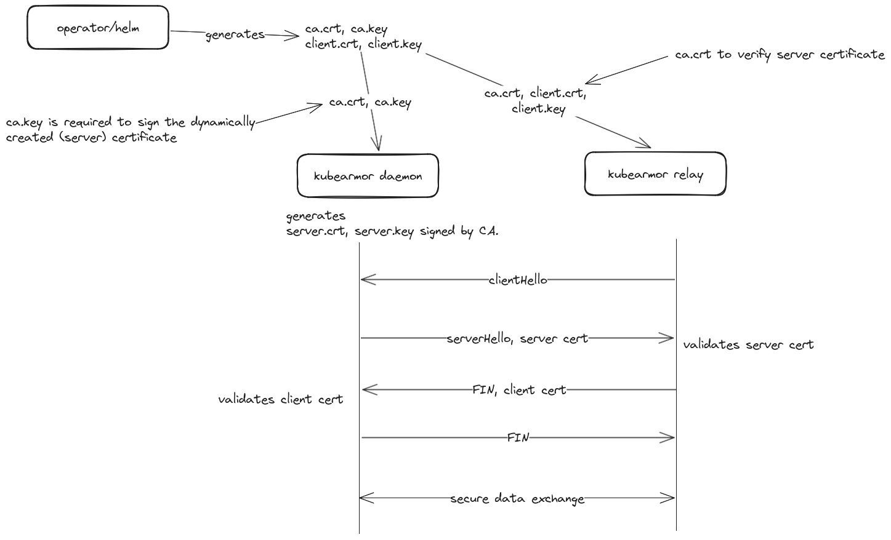

# Security Enhancements for KubeArmor

## 1. Secure Kubearmor with Seccomp

To further enhance the security of KubeArmor itself, it is crucial to protect it using seccomp (secure computing mode), a Linux kernel feature that restricts the system calls (syscalls) a process can make, thereby reducing the attack surface.

With this, Kubearmor will only be using Syscalls necessary to function.


### Enabling seccomp in Kubearmor Configuration 

By default, seccomp is disabled.

In the [Kubearmor Config](https://github.com/kubearmor/KubeArmor/blob/main/pkg/KubeArmorOperator/config/samples/sample-config.yml), set `seccompEnabled: true` and do a `kubectl apply -f config.yaml` to enable seccomp hardening for Kubearmor.

You can check out https://github.com/kubearmor/KubeArmor/blob/bbdc04d4dea3c3e717821e4894f46bd7b30c0d4b/pkg/KubeArmorOperator/seccomp/seccomp.go#L19 to see the list of Syscalls that are allowed by Kubearmor after it is enabled.

### Debugging

There may be some environments where seccomp profiles might not work, for example a K8s environment where the Kubelet path is different than the default `/var/lib/kubelet`. We are currently in the process of defining our own Kubelet path in a future update.

Other issues like missing syscalls in a particular K8s setup is possible, in that case raise an issue in the [repo](https://github.com/kubearmor/KubeArmor/issues).


## 2. Secure gRPC Communication

KubeArmor separates log streaming from standalone policy management. The daemon
enables mutual TLS (mTLS) by default: clients must trust the server's CA and present
a client certificate trusted by that endpoint. KubeArmor Relay also supports mTLS.



The diagram shows the Kubernetes observability connection between the agent and
relay. Standalone management uses a separate endpoint and CA, described below.

### Breaking changes and upgrade requirements

The following changes affect upgrades from agents that served standalone management
RPCs on the log port:

| Setting or interface | Previous behavior | Current behavior |
| --- | --- | --- |
| Daemon `tlsEnabled` default | `false` | `true`; plaintext clients cannot connect unless TLS is explicitly disabled |
| Daemon `tlsCertPath` default | `/var/lib/kubearmor/tls` | `/var/lib/kubearmor/tls/log` |
| Standalone policy, probe, and state RPCs | Shared log endpoint on `32767` | Separate management endpoint on `32765` |
| gRPC reflection | Available on the log endpoint | Available only on the non-Kubernetes management endpoint |

The default certificate provider is still `self`. It requires a CA certificate and
private key to exist before startup; it does **not** bootstrap a CA or client
identity. In particular, installing a `.deb` on an empty host does not provision
these certificates. Follow the [VM installation prerequisites](kubearmor_vm.md#prepare-certificates-before-installation)
before installing the package, whose post-install script starts the service.

These are daemon defaults. Helm and the operator explicitly configure TLS, so their
existing TLS enable/disable settings still apply; see [Kubernetes configuration](#kubernetes-configuration).

### Endpoints

| Default endpoint | Services | Availability and authentication |
| --- | --- | --- |
| TCP `32767` (`gRPC`) | `LogService`: logs, alerts, messages, and its `HealthCheck` RPC | Kubernetes and standalone; mTLS when `tlsEnabled: true` |
| TCP `32765` (`managementGRPC`) | `PolicyService`, `ProbeService`, and `StateAgent` when enabled; management health and reflection | Standalone only; mTLS when `tlsEnabled: true` |
| TCP `32766` (`gRPCHealthPort`) | Standard gRPC health checks only | Kubernetes and standalone; plaintext for health probes |

The log server does not expose policy, probe, state, reflection, or the standard
`grpc.health.v1.Health` service. Its existing `LogService.HealthCheck` RPC remains
available. The dedicated health server continues to report registered service
health, including management services in standalone mode. Those management statuses
are also reported by the management endpoint. Health checks do not provide access
to the underlying policy or log APIs.

In Kubernetes mode, no management listener is created. Policies continue to use
Kubernetes CRDs, and no management port or management CA mount is needed. Since the
log endpoint no longer provides reflection, tools such as `grpcurl` need the
[protobuf definitions](../protobuf) to call log RPCs. Reflection on the standalone
management endpoint lists its management services, not the log services.

By default, the management TCP listener binds to all interfaces on `32765`.
Set `managementFallbackAddr: "127.0.0.1:32765"` to restrict it to local access, or
configure the required interface and firewall rules for remote administration.
Setting `managementSocketPath` selects a Unix domain socket instead of TCP. The
socket's parent directory must exist and have appropriate permissions. A socket
bind failure stops initialization; it does not fall back to TCP. TLS settings still
apply to the socket, and clients must support that transport and verify the server
identity.

### Certificate providers and directories

One `tlsCertProvider` setting selects the provider for both active KubeArmor
servers. Their directories remain separate:

```yaml
# KubeArmor daemon configuration; these are the TLS defaults.
tlsEnabled: true
tlsCertProvider: self
tlsCertPath: /var/lib/kubearmor/tls/log
managementTLSCertPath: /var/lib/kubearmor/tls/management
```

Use different CAs and client identities for logs and management. A log reader must
not receive management credentials. Separate paths alone do not isolate trust if
the same CA is placed in both directories.

| Provider | Files required in each active server's directory | Behavior |
| --- | --- | --- |
| `self` (default) | `ca.crt`, `ca.key` | Signs a server certificate in memory at startup. The CA key must be PEM-encoded RSA in PKCS#1 format. Does not create the CA or a client certificate. |
| `external` | `ca.crt`, `server.crt`, `server.key` | Loads an externally issued server identity. The CA private key is not required on the agent. |
| `dev` | A writable directory | Creates development CA, server, and client certificate/key pairs when missing. Intended for development and CI only; does not renew expired certificates automatically. |

For example, to use certificates issued by your PKI, set `tlsCertProvider: external`
and provision the three server files above in **both** directories for standalone
mode. Add or update these keys in `/opt/kubearmor/kubearmor.yaml` for the packaged
service, preserving its other settings, then restart KubeArmor. Both servers use
`external`; there is no separate management certificate-provider setting.

Clients need the endpoint's `ca.crt`, their own `client.crt`, and `client.key`.
Issue client certificates for client authentication and server certificates for
server authentication. Server SANs must cover the DNS name or IP used by the
client, such as `localhost` for local connections. Do not copy `ca.key` to log
readers or remote management clients. Protect private keys with owner-only access.
The agent's `self` provider and a client's use of a persisted client certificate
are compatible; they do not need identically named provider settings.

### Upgrade a standalone deployment

1. Select compatible agent and `karmor` versions. Use a client with management mTLS and
   `logs --nonk8s` / `probe --nonk8s` support, introduced in
   [kubearmor-client PR #561](https://github.com/kubearmor/kubearmor-client/pull/561).
   Older clients that send policy or probe RPCs to `32767` cannot manage the new
   agent. The updated policy client does not retry over plaintext on the log port.
2. Provision and verify credentials **before** replacing or restarting the agent.
   Move or copy existing log credentials to `/var/lib/kubearmor/tls/log`, or set
   `tlsCertPath` explicitly to their existing location. Provision an independent
   management CA and client identity under `/var/lib/kubearmor/tls/management`.
   For `external`, also provision each server's certificate and key.
3. Update custom mounts and configuration to match those paths. Select one
   provider for both servers and keep `tlsEnabled: true`. Limit access to the new
   management listener to administrators.
4. Point policy, standalone probe, and state clients at `32765`, using management
   credentials. Keep log clients on `32767`, using log credentials. For `karmor`,
   management address/path overrides are `--gRPC` / `--managementTLSCertPath` or
   `KUBEARMOR_MANAGEMENT_SERVICE` / `KUBEARMOR_MANAGEMENT_TLS_CERT_PATH`. Log address
   overrides remain `--gRPC` or `KUBEARMOR_SERVICE`; local log credentials use
   `--tlsCertPath`.
5. Deploy the selected agent and client together, then restart the service and
   verify both `karmor probe --nonk8s` and `karmor logs --nonk8s` with access to the
   credentials (use `sudo` for the root-owned files in the VM guide). Keep
   infrastructure health probes on `32766`; use the
   authenticated management endpoint for management health or reflection.

An explicit `tlsEnabled: false` disables TLS on **both** active application
listeners. It does not restore policy/probe/state RPCs or reflection on `32767`,
and it is incompatible with the updated standalone `karmor` mTLS commands. Do not
use it as a migration workaround.

### Kubernetes configuration

The KubeArmor operator's `KubeArmorConfig` resource supports:

```yaml
spec:
  tls:
    enable: true
    extraDnsNames: []
    extraIpAddresses: []
```

The Helm chart uses a different key:

```yaml
tls:
  enabled: true
```

Both deployment methods retain their existing default of TLS disabled and pass an
explicit `tlsEnabled` value to the agent. Enable TLS through the operator resource
or Helm values so the agent, relay, and credentials are configured together.
`extraDnsNames` and `extraIpAddresses` add relay server SANs for clients; `localhost`
and `127.0.0.1` are included by default.

When TLS is enabled, the updated Helm chart and operator mount the agent CA at
`/var/lib/kubearmor/tls/log`. Relay certificates remain at
`/var/lib/kubearmor/tls`. Upgrade the deployment configuration along with the agent:
an image-only upgrade with an older operator or custom manifest can leave the CA
at the old path while the new binary expects `log/`. Either update that mount or
explicitly set the agent's `tlsCertPath` to the mounted directory. For Helm custom
values, keep `kubearmor.tls.tlsCertPath` and
`kubearmor.tls.kubearmorCACertVolumeMount[].mountPath` aligned. Do not change the
relay path or add management certificates to the DaemonSet.

See the [Helm values](../deployments/helm/KubeArmor/values.yaml) for the agent and
relay provider, secret, and mount settings. Kubernetes policy commands and log
streaming through the relay retain their existing endpoints.
